<div align="center">
  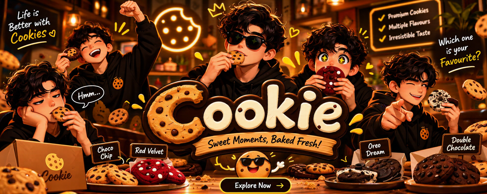
</div>

# 🍪 Cookie — Freshly Baked Artisan Cookies

A responsive, interactive cookie shop frontend built with **HTML, CSS, and vanilla JavaScript**. Cookie brings an artisan bakery experience to the browser with a product catalogue, custom cookie box builder, shopping cart, wishlist, quick-view modals, and a simulated checkout flow.

🔗 **Live Demo:** (https://cookie-craving.netlify.app/)  
📦 **GitHub Repository:** https://github.com/Azeem-Toretto-1/Cookie

---

## ✨ Features

- **Responsive Design** — Layout adapts to desktop, tablet, and mobile screens.
- **Interactive Hero Animation** — Cookies fall, bounce, and react to pointer movement inside the hero bag using Matter.js.
- **Scroll-Based Animations** — GSAP and ScrollTrigger bring page elements and product visuals to life.
- **Featured Products** — Highlighted best-selling cookie selections.
- **Product Catalogue** — Browse six artisan cookie flavours with product details and pricing.
- **Quick View** — Open product details, view calories and allergen information, change quantity, and add items to the cart.
- **Shopping Cart** — Add products, update quantities, remove items, and view calculated totals.
- **Wishlist** — Save favourite cookies and move wishlist items to the cart.
- **Custom Cookie Box Builder** — Choose a box size (4, 6, or 12 cookies), mix flavours, and see the price update dynamically.
- **Checkout Form** — Enter customer and delivery details with client-side validation.
- **Order Confirmation** — View a generated order summary and confirmation screen after the simulated checkout.
- **Persistent Browser Storage** — Cart, wishlist, and the latest order are stored with `localStorage`.
- **Toast Notifications** — Get feedback for cart and wishlist actions.
- **Motion Accessibility** — The hero physics animation respects the `prefers-reduced-motion` setting.

> **Note:** This is a frontend demonstration project. Checkout creates a simulated order in the browser; it does not process real payments, submit orders to a server, or provide live order tracking.

---

## 🧁 Cookie Flavours

| Cookie | Description |
| --- | --- |
| Classic Chocolate | A golden cookie with semi-sweet chocolate pieces. |
| Double Chocolate | Rich cocoa dough with white chocolate chunks. |
| Red Velvet | Velvety cocoa and vanilla with white chocolate chips. |
| Oats & Raisins | Rolled oats, raisins, and warm cinnamon. |
| Peanut Butter Crunch | Roasted peanut butter with crisp edges and a soft centre. |
| White Matcha | Matcha dough balanced with Belgian white chocolate. |

---

## 🛠️ Built With

- **HTML5** — Semantic page structure and content.
- **CSS3** — Responsive layouts, styling, and component-based stylesheets.
- **JavaScript (ES Modules)** — Interactive features and modular application logic.
- **GSAP** — Interface and scroll-triggered animations.
- **GSAP ScrollTrigger** — Scroll-based animation control.
- **Matter.js** — Physics simulation for the interactive cookie hero.
- **Remix Icon** — Interface icons.
- **Google Fonts** — Web typography.

---

## 📸 Screenshots

### Homepage
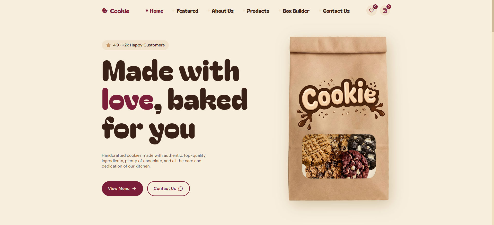

### Featured Products
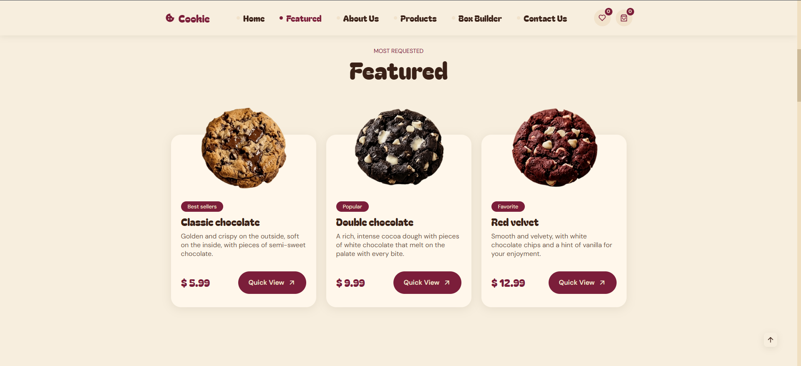

### Products Catalogue
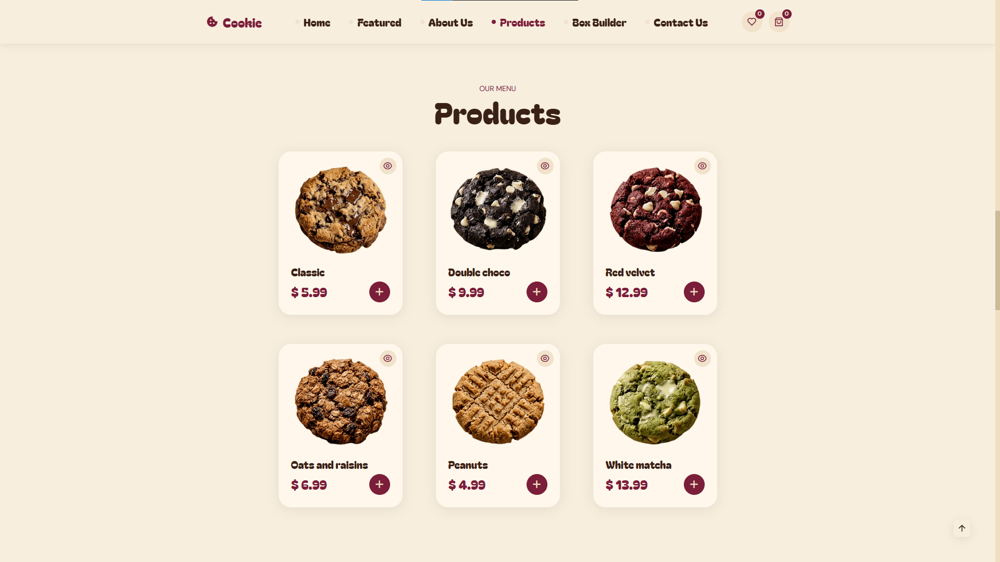

### Custom Box Builder
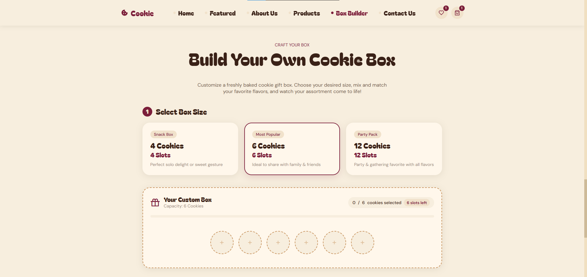

### Quick View
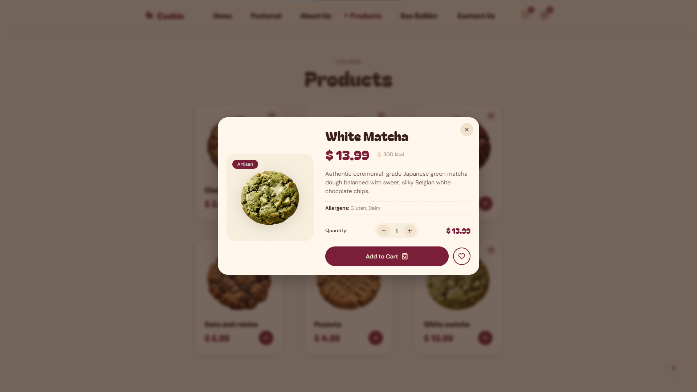

### Shopping Cart
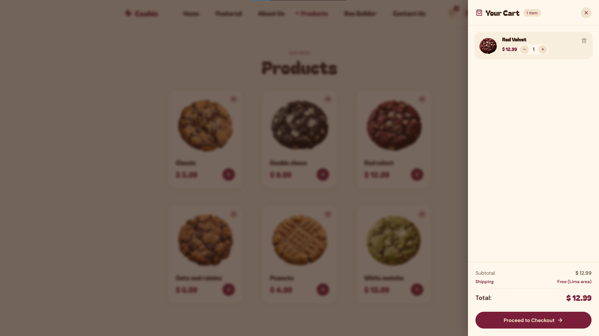

### Wishlist
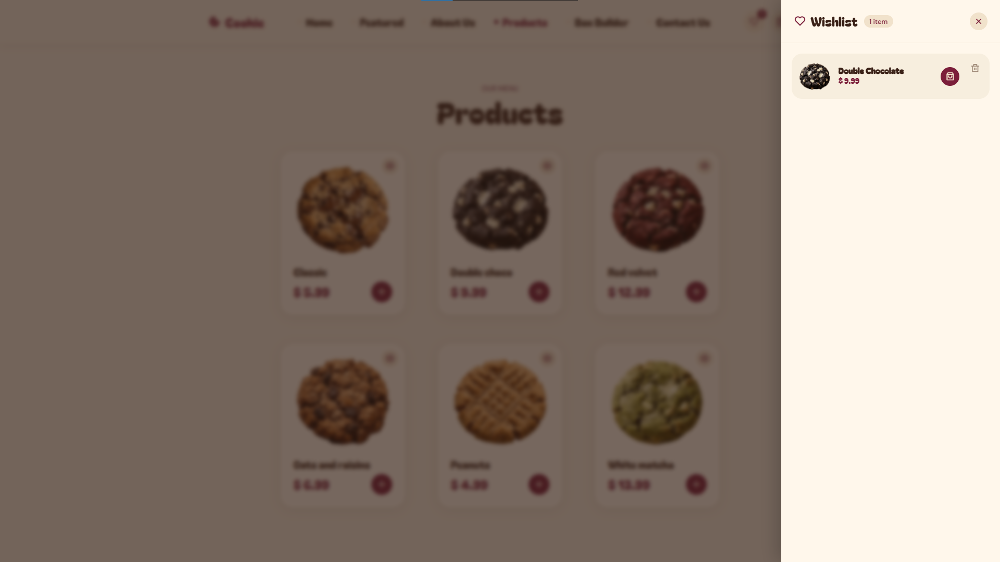

### Checkout
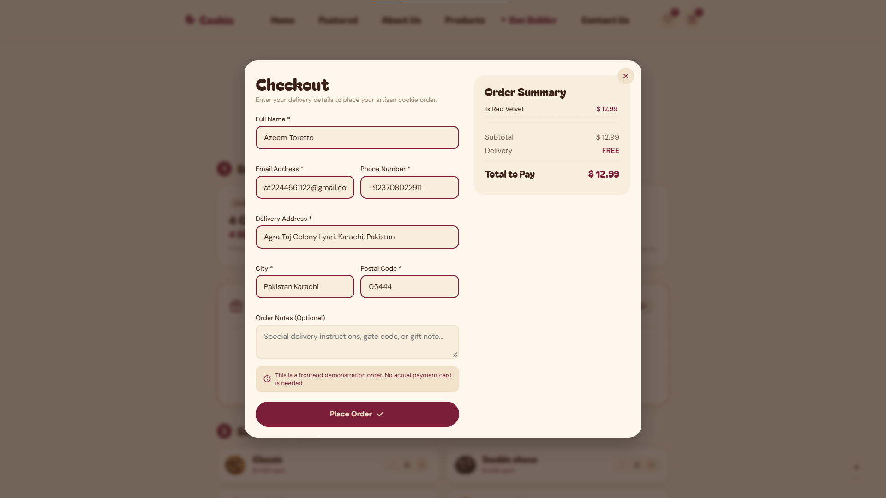

### Order Confirmation
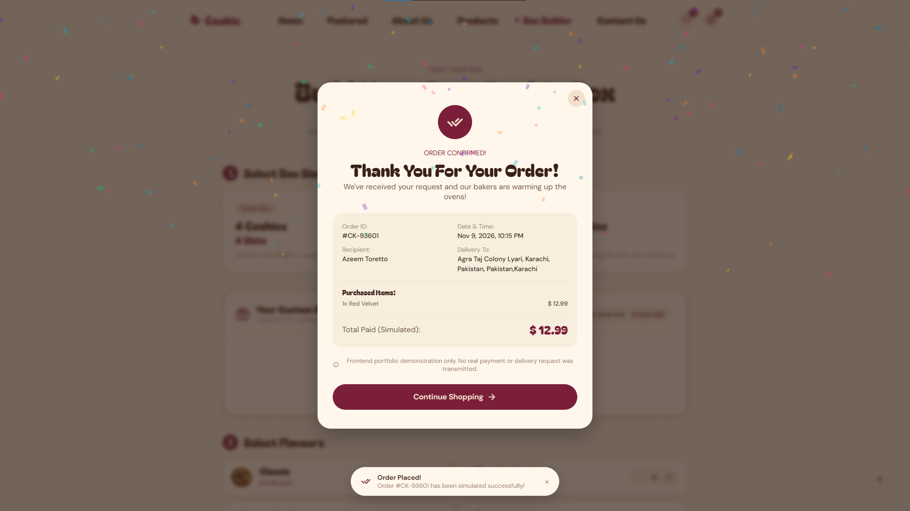

### Mobile View
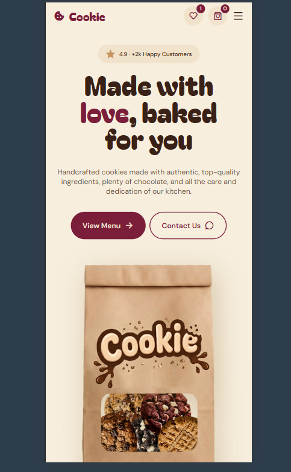

### Project Structure
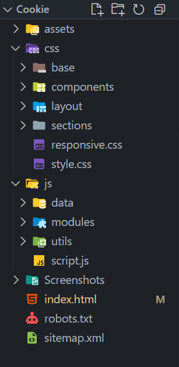

---

## 📂 Project Structure

```text
Cookie/
│
├── assets/
│   └── img/                    # Cookie images, hero artwork, and favicon
│
├── css/
│   ├── base/                   # Reset, typography, and CSS variables
│   ├── components/              # Buttons, cards, cart, forms, modals, etc.
│   ├── layout/                  # Header, navigation, and footer
│   ├── sections/                # Styles for each page section
│   ├── responsive.css            # Responsive breakpoints
│   └── style.css                 # Main CSS entry point
│
├── js/
│   ├── data/
│   │   └── products.js          # Central product catalogue
│   ├── modules/                 # Cart, wishlist, checkout, animations, etc.
│   ├── utils/                   # Shared helper and currency utilities
│   └── script.js                # JavaScript application entry point
│
├── Screenshots/                 # Project screenshots
├── index.html                   # Main page
├── robots.txt
└── sitemap.xml
```

---

## 🚀 Getting Started

Because the project uses native JavaScript ES modules, run it through a local development server rather than opening `index.html` directly.

### 1. Clone the repository

```bash
git clone https://github.com/Azeem-Toretto-1/Cookie.git
```

### 2. Open the project folder

```bash
cd Cookie
```

### 3. Run with a local server

Open the folder in Visual Studio Code and launch `index.html` using the **Live Server** extension.

Alternatively, use any static development server of your choice.

---

## 🧪 Try the Interactive Features

1. Browse the cookie catalogue and open a product using **Quick View**.
2. Change the quantity and add the cookie to your cart.
3. Add products to your wishlist and manage saved favourites.
4. Open **Build Your Own Cookie Box**, choose a box size, and fill every slot with your preferred flavours.
5. Update cart quantities or remove items.
6. Continue to checkout and enter sample customer details to view the simulated order confirmation.

Your cart and wishlist are saved in the current browser using `localStorage`.

---

## 🌐 Connect With Me

- **GitHub:** https://github.com/Azeem-Toretto-1
- **LinkedIn:** https://www.linkedin.com/in/azeem-toretto
- **Instagram:** https://www.instagram.com/azeem_dev
- **YouTube:** https://www.youtube.com/@Azeem_Dev

---

## 📄 License

This project is created for portfolio and educational purposes. Please contact me before reusing the project or its assets in a commercial product.

---

### 💛 Made with passion by Azeem Toretto
